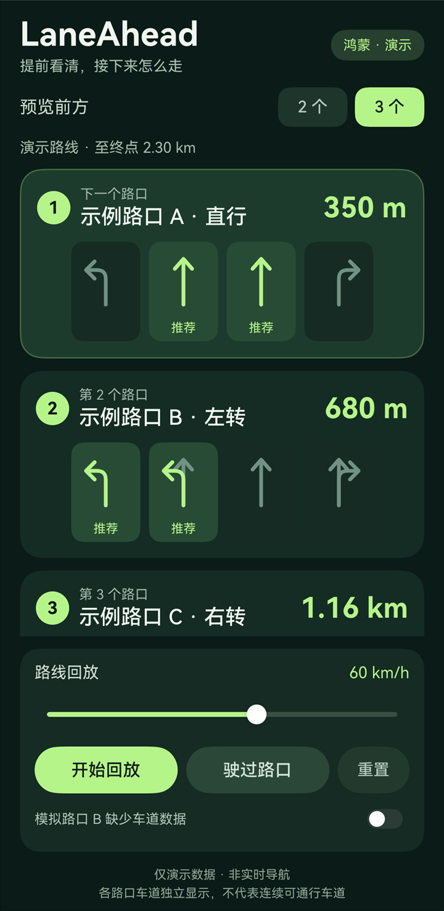
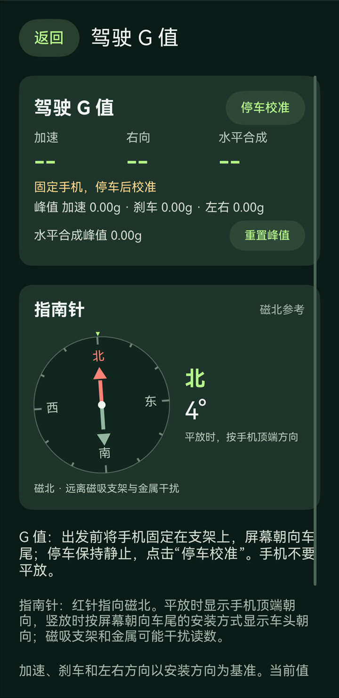

# LaneAhead · HarmonyOS

**提前显示前方多个路口的车道信息，帮助提前选道，为连续路口的转向做准备。**

LaneAhead 是一款自用的原生鸿蒙驾车导航应用：沿选定路线，在导航页顶部集中展示前方 2 / 3 个导航引导点的距离、已知车道及推荐方向，经过后自动更新。

## 多路口车道预览

- **提前看多个点**：同屏查看接下来 2 / 3 个引导点，可切换数量或收起面板。
- **实时车道提示**：显示高德返回的车道与推荐方向，绿色标识实时推荐。
- **走过后留作参考**：仅保存已确认有红绿灯、且满足关联及通过确认条件的路口车道；无红绿灯或无法确认时默认不保存。再次经过匹配路段时，可提前显示，黄色标识历史参考。记录 7 天过期，可在设置中清除。
- **采集状态可查**：导航面板显示采集进度；「设置 → 车道采集诊断」查看最近一次导航的回调、写入统计和未保存原因。

目前预览以高德导航引导点为单位，不覆盖所有物理路口。SDK 未提供完整的未来路口车道列表，首次行驶或缺少匹配记录时，未来点可能显示「暂无车道数据」；历史记录仅供参考。真实车道采集、重复行驶复用及后台/锁屏持续导航尚未完成实车验证。

## 界面预览

| 多路口车道预览（虚构演示） | 驾驶 G 值与指南针 |
| :---: | :---: |
|  |  |

左图为虚构演示，右图为 G 值校准前状态；截图不包含当前定位、真实路线或历史记录。

## 使用

同意定位并授予精确位置权限 → 自动定位当前位置 → 搜索并选择终点 → 选择路线 → 开始 GPS 导航与语音引导，查看顶部「前方车道」。设置中另有指定起点规划与虚构车道演示。

点击首页目的地入口进入独立搜索页，顶部先展示常去地点 Top 5，再展示搜索历史；按已到达次数排序，同次数时最近到达的排前，点击常去地点按其城市重新检索，选择结果后返回地图。常去地点由本机最近 200 次导航历史计算，同名不同城市或地址分别统计；删除导航历史后下次打开更新。

默认先搜索当前城市，没有名称匹配时按最近到达顺序搜索去过的城市，找到名称匹配即停止；精确名称优先，其次包含完整关键词，同等匹配优先展示已到达过的地点。去过城市来自「已到达」的导航历史。跨城可输入「北京 望京花园」或「北京市望京花园」，明确城市或手动范围只搜指定城市。城市默认隐藏，可展开「搜索范围」修改或恢复自动范围；点击「重新定位」恢复当前位置和城市。最近 20 条搜索关键词保存在本机，支持重搜、删除与清空。

首页「我的」查看[导航历史](docs/navigation-history.md)：目的地、开始/结束时间、导航时长、结束状态和出发时规划里程。仅在真实导航开始后记录，本机保留最近 200 次，支持删除和清空；旧版本行驶无法补录。

导航顶部另有[驾驶 G 值](docs/driving-g.md)：显示加速、刹车、左右及水平合成 G 值和本次测量峰值。「设置 → 驾驶 G 值」可独立查看，另有磁北指南针和双轴水平仪。水平仪请屏幕朝上平放，显示气泡及左右、前后倾角，无需 G 值校准。测量仅供参考，尚未完成实车对照验证。

**G 值校准时应竖放手机，不要平放。** 将手机固定在支架上，屏幕大致垂直地面、朝向车尾，顶部朝上，允许适当倾斜；停车后点击「停车校准」，保持静止约 2 秒。调整支架或手机方向后需停车重新校准。

导航地图使用[大众 Logo 车辆标记](docs/vehicle-icon.md)：停车时静止，车速越快旋转越快；顶部尖角保留车辆方向。旋转仅为视觉效果。

## 开发与构建

原生 ArkTS / ArkUI，面向 HarmonyOS 7（API 26），使用高德 HarmonyOS NEXT SDK 11.2.1；版本见 [VERSION](VERSION)。用 DevEco Studio 打开项目并同步 OHPM 依赖，运行模块选择 `entry`。在仓库根目录使用 PowerShell 7：

```powershell
pwsh -NoProfile -File .\scripts\build.ps1 -TestOnly  # 逻辑测试
pwsh -NoProfile -File .\scripts\build.ps1            # 测试、编译与打包
```

脚本默认使用 `D:\programs\DevEcoStudio`，其他路径传入 `-DevEcoHome`。构建自动同步版本、准备本机 Key；产物位于 `artifacts/LaneAhead-<版本>-unsigned.hap`，配置签名后另有 `-signed.hap`。

## 本机配置

- `.local/gaode`：高德 Web 服务 Key，用于城市识别、地点搜索与 Web 规划。
- `.local/gaode-harmony`：高德 HarmonyOS NEXT Key，须绑定当前签名的完整 AppID。
- 真机签名：在 DevEco Studio 的 **Project Structure → Signing Configs** 配置；手机开启 USB 调试并授权后运行 `entry`。

构建将 Key 注入被 Git 忽略的资源，安装后自动使用，设置页不提供 Key 输入。更换 Key 后需重新构建安装；实际 Key、签名凭据和安装包仅保留在本机。

开发约定见 [AGENTS.md](AGENTS.md)；车道数据来源、缓存规则与验证范围见 [接入说明](docs/lane-data-integration.md)。
